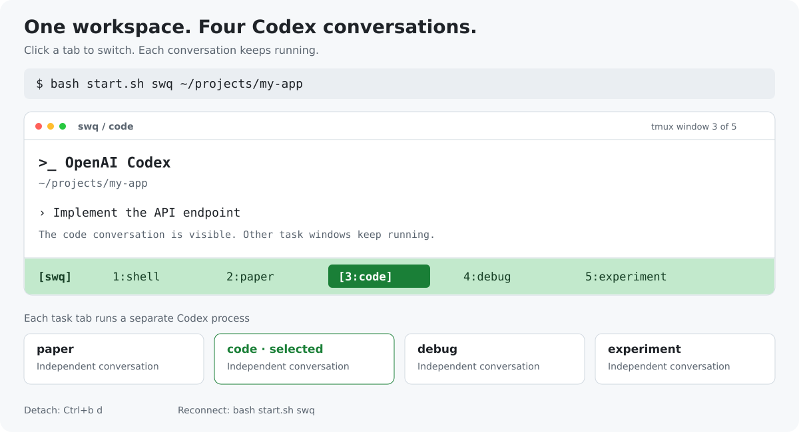

<div align="center">

# Codex CLI with tmux

**一个终端，多个独立 Codex 对话；点击底部标签切换，断线后接着工作。**

Multiple Codex conversations in one tmux workspace.


[快速开始](#快速开始) · [工作方式](#工作方式) · [快捷键](#常用快捷键) · [断线重连](#断线重连) · [可选主题](#可选浅色主题) · [常见问题](#常见问题)

</div>



*工作方式示意，非终端实拍。窗口名是用途标签，不会自动为 Codex 分配任务。*

## 为什么用它

写论文、改代码、排查问题、跑实验时，经常需要保留几个不同的 Codex 对话。这个项目用 tmux 把它们放在同一个终端里：

- **一条命令启动**：一个普通 shell 标签，四个分别运行 Codex 的工作标签。
- **点击切换**：鼠标点击底部窗口名，也可以用 tmux 快捷键。
- **保留上下文**：切换标签不退出 Codex，各自的进程和对话继续存在。
- **断线后继续**：SSH 断开或退出前台后，重新连接已有工作区。
- **重复启动可复用**：再次执行启动脚本只连接已有会话，不重启其中的 Codex。

主题配色是附加功能。核心工作流不需要安装 Python、修改 Codex 主题，或安装其他会话编排工具。

## 快速开始

需要 Bash、tmux，以及已安装并完成登录的 Codex CLI。先确认当前终端能执行：

```bash
tmux -V
codex --version
```

下载并启动：

```bash
git clone https://github.com/Stars-Shen/Codex-CLI-with-Tmux.git
cd Codex-CLI-with-Tmux
bash start.sh swq ~/projects/my-app
```

将 `~/projects/my-app` 替换成你的项目目录。也可直接在当前目录启动：

```bash
bash /path/to/Codex-CLI-with-Tmux/start.sh swq
```

参数格式：

```text
bash start.sh [tmux 会话名] [工作目录]
```

省略参数时，会话名为 `codex`，工作目录为当前目录。首次运行创建五个窗口，并默认选中 `code`：

```text
tmux session: swq
│
├── 1:shell        普通终端
├── 2:paper        Codex CLI → 论文相关对话
├── 3:code         Codex CLI → 编码相关对话
├── 4:debug        Codex CLI → 排查问题的对话
└── 5:experiment   Codex CLI → 实验相关对话

[swq]  1:shell  2:paper  [3:code]  4:debug  5:experiment
```

四个 Codex 窗口在同一个初始工作目录中分别启动，任务内容由你在各窗口输入。首次启动可能需要在窗口内确认 Codex 的项目或登录提示。

## 工作方式

**tmux session 是工作区，tmux window 是标签，每个工作标签运行一个 Codex CLI 进程。**

这四个窗口对应四个独立 Codex 对话，不是一个对话的四个视图，也不会自动互相传递消息。窗口名只是方便记忆用途，你可以用 `Ctrl+b ,` 重命名。

这些进程仍使用同一个用户账号、Codex 配置和额度；默认也共享项目文件。需要并行修改不同版本时，可以使用不同目录或 Git worktree。

### 切换与继续

直接点击底部的 `paper / code / debug / experiment`，或用键盘切换。退出某个 Codex 后，该窗口会回到普通 shell，可运行：

```bash
codex resume
```

从列表中选择该窗口对应的对话。需要全新对话时运行 `codex`。不要在所有窗口都恢复同一个最近对话：那会指向同一条记录，不能作为相互独立的工作对话。

### 管理多个项目

用不同会话名创建不同工作区：

```bash
bash start.sh paper ~/projects/paper
bash start.sh app ~/projects/app
```

已有会话名会直接复用，脚本不会重新配置它、补齐窗口或更改其工作目录；重新接入时可省略目录参数。

在 tmux 内执行脚本会切换会话；在普通终端中执行会连接会话，不需要手动清除 `TMUX` 变量。

## 常用快捷键

先按 `Ctrl+b`，松开，再按后面的键：

| 按键 | 操作 |
| --- | --- |
| `1` … `5` | 切换到对应编号的窗口 |
| `n` / `p` | 下一个 / 上一个窗口 |
| `c` | 创建一个新的 shell 窗口，可自行运行 `codex` |
| `,` | 重命名当前窗口 |
| `s` | 选择 tmux 会话 |
| `d` | 离开 tmux，后台任务继续 |

鼠标点击切换由启动脚本为新工作区开启。滚动或选中文字进入 tmux 复制模式后，可用 `q` 或 `Esc` 返回实时画面。

## 断线重连

重新登录服务器后，再次运行同一个入口：

```bash
cd Codex-CLI-with-Tmux
bash start.sh swq
```

或者从普通终端直接连接：

```bash
tmux attach -t swq
```

tmux 中的进程通常会在 SSH 断开后继续运行；服务器重启、会话被删除或进程自行退出不在此范围内。保留窗口不代表正在进行的网络请求一定成功。

## 启动脚本会修改什么

首次创建时，仅给新会话及其五个窗口设置鼠标、底部标签栏、编号和标签格式。`PATH` 从启动终端传入工作区，启动的进程会移除 `NO_COLOR`；系统具备对应 terminfo 时使用 `tmux-256color`。

它不会覆盖 `~/.tmux.conf`、修改 Codex 主题，或关闭你已有的其他会话。若 tmux 服务尚未启动，tmux 本身仍会按正常行为读取用户配置。

希望把类似设置应用到手动创建的窗口，可参考 [tmux 配置示例](examples/tmux.conf)，检查后自行合并到用户配置。

## 可选浅色主题

如果白底终端中的 `Edited` 差异块出现过深的绿、红背景，可以额外安装 `codex-light`：

```bash
python3 install.py
```

这一步需要 Python ≥ 3.8。它是独立的主题安装器，不是多会话工作区的启动入口。安装后在 Codex 中运行 `/theme`，选择 `codex-light (custom)`。

[查看主题对比、安装和恢复说明 →](docs/light-theme.md)

## 常见问题

**tmux 提示 `sessions should be nested with care`？**

说明你已在 tmux 内又尝试了 `attach`。使用 `bash start.sh swq` 会自动选择切换方式；也可以直接执行 `tmux switch-client -t swq`。

**Codex 或整个终端看起来卡住？**

先区分范围：

- 只有 Codex 不动、标签还能切换：检查该 Codex 的任务或网络状态。
- 滚动、拖选后停在历史画面：尝试退出复制模式。
- 键盘和标签都无响应：另开终端执行 `date` 与 `tmux list-sessions`，区分终端连接和 tmux 服务的问题。

如果新终端能正常响应，可重新连接并断开旧客户端：

```bash
tmux attach -d -t swq
```

`-d` 会断开该会话的其他终端连接，保留会话中的任务。

**窗口都叫 Codex，分不清任务？**

新工作区会保留设置的窗口名，并关闭这些窗口的自动命名。用 `Ctrl+b ,` 按实际任务重命名即可。

**缺少 tmux 或 Codex？**

脚本不会自动安装系统依赖。安装 tmux，并确保当前终端能正常运行 Codex；例如先手动完成一次 `codex` 登录，再启动工作区。

## 验证

```bash
python3 -m unittest discover -s tests -v
```

主题测试使用临时 Codex 目录。工作区测试使用独立的 tmux socket 和假的 Codex 程序，验证多个独立进程、工作目录、已有会话复用和会话内切换；不会启动真实模型任务或修改你的工作会话。

已在 Bash、tmux 3.0a 环境验证；浅色主题曾在 Codex CLI 0.162.1 上验证。

## 参考与许可

- [tmux 官方手册](https://man.openbsd.org/tmux)：会话、窗口、鼠标与连接命令。
- [可选主题说明与上游来源](docs/light-theme.md)。

这是社区工作流工具，不是 OpenAI 官方项目。启动脚本、安装器、文档和展示素材采用 [MIT License](LICENSE)；Catppuccin 派生主题保留原始 [MIT 许可证](codex-light.LICENSE)。
