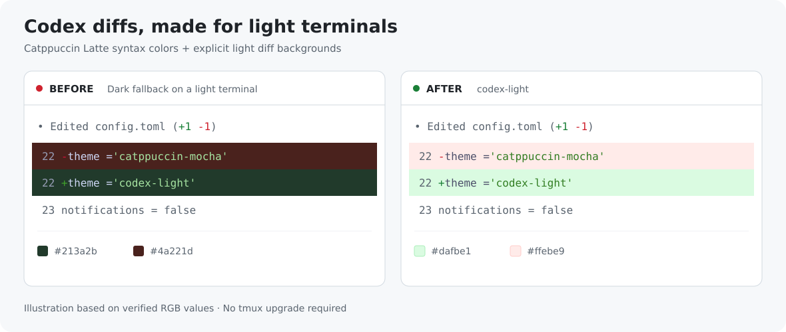
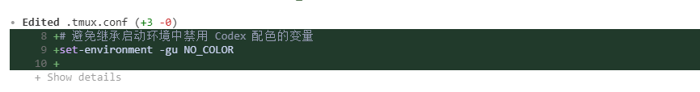

# 可选：浅色终端主题

[返回多 Codex 会话工作区 →](../README.md)

多会话启动入口是 `bash start.sh`。本文的 `python3 install.py` 仅安装附加主题，不负责启动或管理 tmux。

## 解决什么问题

在白底终端中运行 Codex CLI 时，旧版 tmux 可能无法回答背景颜色查询，导致 `Edited` 下方出现很深的绿色或红色差异块。

`codex-light` 沿用 Codex 默认浅色方案 Catppuccin Latte，并固定采用 Codex 的浅色差异背景：新增行 `#dafbe1`，删除行 `#ffebe9`。它是社区兼容主题，不是 OpenAI 官方发布的独立主题。



*依据实际验证的 RGB 配色绘制的示意，非终端实拍。*

<details>
<summary>最初的问题截图</summary>



</details>

## 安装

在仓库根目录执行：

```bash
python3 install.py
```

需要 Python ≥ 3.8，以及支持 `/theme`、自定义 `.tmTheme` 和差异范围背景的 Codex CLI。主题已在 Codex CLI 0.162.1 + tmux 3.0a 上验证。安装使用 Python 标准库，无需联网、sudo 或 pip 依赖。

正在运行的 Codex 中输入 `/theme`，选择 `codex-light (custom)` 立即应用。新启动的 Codex 自动读取已保存的配置。

## 修改范围

默认安装到 `~/.codex`；已设置标准变量 `CODEX_HOME` 时使用对应目录。只安装 `themes/codex-light.tmTheme`、原始许可证，并设置：

```toml
[tui]
theme = "codex-light"
```

其他配置保留。文件发生变化前，安装器会创建同目录 `.backup-时间戳` 备份，并打印路径；重复安装且内容不变时，不写文件或新增备份。不会修改 tmux 或 shell 初始化配置。

## 恢复

只想换主题时，在 Codex 中运行 `/theme`，选择内置主题即可：浅色终端可选 `catppuccin-latte`，深色终端可选 `catppuccin-mocha`。旧 tmux 的背景查询限制仍可能影响内置主题的差异背景。

要恢复整份原配置，将安装器打印的备份路径替换到下面命令中：

```bash
cp '/实际路径/config.toml.backup-时间戳' ~/.codex/config.toml
```

使用 `CODEX_HOME` 时相应调整目标。整份恢复会覆盖备份之后的修改；仅切换主题时优先使用 `/theme`。

## 常见问题

**没有颜色？** 启动脚本创建的进程会移除 `NO_COLOR`。其他旧终端可能仍保留它，退出 Codex 后执行 `unset NO_COLOR` 再启动。`env -u NO_COLOR codex` 只对那次启动有效。

**配置使用 `tui = { ... }` 或 `tui.theme = ...`？** 安装器支持标准 `[tui]` 表；遇到内联或点号写法会停止且不改动文件。可在仓库根目录手动执行：

```bash
mkdir -p ~/.codex/themes
cp codex-light.tmTheme codex-light.LICENSE ~/.codex/themes/
```

再通过 `/theme` 选择主题。使用 `CODEX_HOME` 时，目标改为对应的 `themes/`。

**深色终端适用吗？** 主题固定浅色差异背景，主要面向白底、浅色终端。深色终端优先使用内置深色主题。

**它控制 tmux 底栏吗？** 不控制。Codex 主题与 tmux 状态栏是独立界面；本主题也不会改变状态行项目，可用 `/statusline` 自行选择项目。

## 上游来源

- [Codex 官方主题机制](https://learn.chatgpt.com/docs/cli-customization)
- [Codex v0.162.1 默认浅色主题选择](https://github.com/openai/codex/blob/rust-v0.162.1/codex-rs/tui/src/render/highlight.rs)
- [Codex v0.162.1 差异背景配色](https://github.com/openai/codex/blob/rust-v0.162.1/codex-rs/tui/src/diff_render.rs)
- [Catppuccin Latte 主题](https://github.com/catppuccin/bat/blob/main/themes/Catppuccin%20Latte.tmTheme)，保留原作者署名和 [原始 MIT 许可证](../codex-light.LICENSE)。
